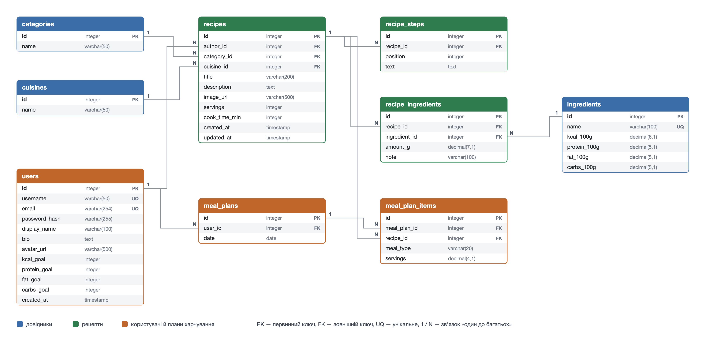

# Порція 🥗

Сайт рецептів, де для кожної страви одразу видно **КБЖВ на одну порцію** (калорії, білки, жири, вуглеводи), а з рецептів можна скласти план харчування на день і побачити, скільки КБЖВ виходить разом.

Домашнє завдання курсу ВПА2026 «REST API Design»: тема сайту, архітектура REST API і схема бази даних. Код сайту буде в наступних завданнях.

## Зміст

- [Ідея сайту](#ідея-сайту)
- [Що є на сайті](#що-є-на-сайті)
- [Як рахується КБЖВ](#як-рахується-кбжв)
- [REST API](#rest-api)
  - [Загальні правила](#загальні-правила)
  - [Реєстрація і вхід](#реєстрація-і-вхід)
  - [Профіль](#профіль)
  - [Рецепти](#рецепти)
  - [Інгредієнти](#інгредієнти)
  - [Категорії та кухні](#категорії-та-кухні)
  - [Автори](#автори)
  - [План харчування](#план-харчування)
  - [Про нас](#про-нас)
- [Схема бази даних](#схема-бази-даних)

## Ідея сайту

Я сама цікавлюся харчуванням і рахую КБЖВ, і найнезручніше в цьому те, що на більшості сайтів з рецептами КБЖВ або немає, або воно вказане на всю страву чи на 100 г, і доводиться перераховувати вручну. «Порція» вирішує це так:

- у кожного рецепта КБЖВ вже пораховане **на одну порцію**;
- рецепти можна шукати не тільки за назвою, а й за інгредієнтом («що приготувати з нуту?») і відбирати за калоріями та білками;
- з рецептів можна зібрати **план харчування на день**: сайт сам підсумує КБЖВ і порівняє з твоєю денною ціллю, а ще складе список покупок.

## Що є на сайті

**Каталог рецептів.** Головна сторінка зі списком страв: фото, назва, час приготування і КБЖВ на порцію. Можна:

- шукати за назвою страви або за інгредієнтом;
- фільтрувати за категорією (суп, салат, основна страва, випічка, десерт…), кухнею (українська, італійська, азійська…), автором, а також за максимумом калорій і мінімумом білків на порцію;
- сортувати від найменш калорійних, від найбільш калорійних, за кількістю білків, за часом приготування, за популярністю і від найновіших.

**Сторінка рецепта.** Фото, опис, кількість порцій, час приготування, автор, категорія і кухня, список інгредієнтів з грамовкою, покрокове приготування і КБЖВ на порцію. Звідси рецепт можна додати в план харчування.

**Інгредієнти.** Перелік інгредієнтів з КБЖВ на 100 г. На сторінці інгредієнта видно всі рецепти, де він використовується.

**Автори.** Перелік людей, які опублікували рецепти. На сторінці автора видно інформацію про нього і всі його рецепти.

**Додавання і редагування.** Рецепти, інгредієнти, категорії та кухні можна додавати, редагувати й видаляти.

**Реєстрація і профіль.** Можна зареєструватися і залогінитися. У профілі можна змінити дані про себе і задати денну ціль: скільки калорій, білків, жирів і вуглеводів хочеш з'їдати.

**План харчування** (замість кошика й замовлень з прикладу з книгарнею). Залогінений користувач додає рецепти в план на конкретний день (сніданок, обід, вечеря, перекус) і вказує, скільки порцій з'їсть. Сайт показує:

- сумарне КБЖВ за день і скільки лишилося до цілі;
- список покупок: усі інгредієнти з плану, складені разом;
- історію планів за минулі дні.

**Про нас.** Контакти, як рахується КБЖВ і застереження, що сайт не замінює консультацію дієтолога.

## Як рахується КБЖВ

КБЖВ ніхто не вводить вручну, воно рахується з інгредієнтів:

1. Для кожного **інгредієнта** зберігається КБЖВ на 100 г (наприклад, куряче філе: 110 ккал, 23 г білків, 1,2 г жирів, 0 г вуглеводів).
2. Для кожного **рецепта** зберігається, скільки грамів кожного інгредієнта в ньому, і на скільки порцій він розрахований.
3. КБЖВ на порцію = сума по всіх інгредієнтах (`грами / 100 × КБЖВ на 100 г`), поділена на кількість порцій.

Тому якщо змінити грамовку в рецепті або КБЖВ інгредієнта, КБЖВ порції перерахується автоматично. КБЖВ дня в плані харчування = сума `КБЖВ порції × кількість порцій` по всіх стравах дня.

> TBD: рахувати КБЖВ щоразу при запиті чи зберігати готові значення в таблиці `recipes` і оновлювати їх при зміні рецепта (так буде простіше сортувати каталог за калоріями). Вирішу, коли буду писати код.

## REST API

### Загальні правила

- Базова адреса: `/api`.
- Дані передаються у форматі **JSON** (`Content-Type: application/json`).
- Назви ресурсів — іменники в множині (`/recipes`, `/ingredients`), дії задаються HTTP-методом:

  | Метод | Що робить |
  |---|---|
  | `GET` | отримати дані |
  | `POST` | створити новий об'єкт |
  | `PATCH` | змінити частину полів об'єкта |
  | `DELETE` | видалити об'єкт |

- Фільтрування, пошук, сортування і сторінки списку задаються query-параметрами: `/api/recipes?category=2&sort=kcal&page=2`.
- Списки повертаються сторінками у такому форматі:

  ```json
  {
    "count": 134,
    "page": 2,
    "page_size": 20,
    "results": [ ... ]
  }
  ```

- 🔒 позначає ендпоінти, які доступні тільки залогіненому користувачу.

  > TBD: авторизацію додамо в окремому завданні, тоді ж оберу спосіб (сесія чи токен) і визначу, хто може редагувати інгредієнти, категорії й кухні: будь-який користувач чи тільки адміністратор.

**Статуси відповідей**, які використовуються в усьому API:

| Статус | Коли |
|---|---|
| `200 OK` | успішне отримання або зміна даних |
| `201 Created` | об'єкт створено |
| `204 No Content` | об'єкт видалено, тіла відповіді немає |
| `400 Bad Request` | неправильні дані в запиті (не заповнене обов'язкове поле, від'ємні грами тощо) |
| `401 Unauthorized` | користувач не залогінений, а ендпоінт 🔒 |
| `403 Forbidden` | користувач залогінений, але не має права на цю дію (наприклад, редагує чужий рецепт) |
| `404 Not Found` | об'єкта з таким id немає |
| `409 Conflict` | дію не можна виконати через інші дані (наприклад, такий email уже зареєстрований) |

Формат помилки однаковий для всіх ендпоінтів:

```json
{
  "error": "validation_error",
  "message": "Перевірте введені дані",
  "fields": {
    "servings": "Кількість порцій має бути більше 0"
  }
}
```

---

### Реєстрація і вхід

#### `POST /api/auth/register` — реєстрація

Request body:

```json
{
  "username": "nastya",
  "email": "nastya@example.com",
  "password": "secret123",
  "display_name": "Настя"
}
```

Response `201 Created`:

```json
{
  "id": 7,
  "username": "nastya",
  "email": "nastya@example.com",
  "display_name": "Настя"
}
```

Помилки: `400` — не заповнені поля або закороткий пароль, `409` — такий username або email уже зайнятий.

#### `POST /api/auth/login` — вхід

Request body:

```json
{
  "email": "nastya@example.com",
  "password": "secret123"
}
```

Response `200 OK`: дані користувача (як у реєстрації).

Помилки: `401` — неправильний email або пароль.

> TBD: що саме повертає вхід (сесійна cookie чи токен) — визначу, коли буду робити авторизацію.

#### `POST /api/auth/logout` 🔒 — вихід

Request body немає. Response `204 No Content`.

---

### Профіль

#### `GET /api/me` 🔒 — мій профіль

Response `200 OK`:

```json
{
  "id": 7,
  "username": "nastya",
  "email": "nastya@example.com",
  "display_name": "Настя",
  "bio": "Люблю готувати швидкі сніданки",
  "avatar_url": "https://example.com/avatars/7.jpg",
  "daily_goal": {
    "kcal": 1800,
    "protein": 110,
    "fat": 60,
    "carbs": 200
  },
  "created_at": "2026-10-12T14:30:00Z"
}
```

#### `PATCH /api/me` 🔒 — редагувати профіль і денну ціль

Request body — тільки поля, які змінюються:

```json
{
  "bio": "Рахую КБЖВ і люблю азійську кухню",
  "daily_goal": { "kcal": 1700, "protein": 120 }
}
```

Response `200 OK`: оновлений профіль (як у `GET /api/me`). Помилки: `400` — від'ємні значення цілі.

> Мої рецепти — це `GET /api/recipes?author=<мій id>`, мої плани харчування — розділ [План харчування](#план-харчування).

---

### Рецепти

#### `GET /api/recipes` — каталог рецептів

Query-параметри (усі необов'язкові):

| Параметр | Приклад | Що робить |
|---|---|---|
| `search` | `search=сирники` | пошук за назвою рецепта |
| `ingredient` | `ingredient=12` | тільки рецепти з цим інгредієнтом (id); можна кілька: `ingredient=12&ingredient=5` |
| `category` | `category=3` | фільтр за категорією (id) |
| `cuisine` | `cuisine=1` | фільтр за кухнею (id) |
| `author` | `author=7` | рецепти одного автора (id) |
| `max_kcal` | `max_kcal=400` | не більше стількох калорій на порцію |
| `min_protein` | `min_protein=25` | не менше стількох грамів білків на порцію |
| `max_time` | `max_time=30` | готується не довше стількох хвилин |
| `sort` | `sort=kcal` | `kcal` — від найменш калорійних, `-kcal` — від найбільш калорійних, `-protein` — від найбільшої кількості білків, `time` — від найшвидших, `popular` — за популярністю (скільки разів рецепт додавали в плани), `-created_at` — від найновіших (за замовчуванням) |
| `page`, `page_size` | `page=2&page_size=20` | сторінка списку (за замовчуванням 1 і 20) |

Response `200 OK`:

```json
{
  "count": 2,
  "page": 1,
  "page_size": 20,
  "results": [
    {
      "id": 15,
      "title": "Сирники в духовці",
      "image_url": "https://example.com/recipes/15.jpg",
      "cook_time_min": 30,
      "servings": 4,
      "category": { "id": 1, "name": "Сніданки" },
      "cuisine": { "id": 1, "name": "Українська" },
      "author": { "id": 7, "display_name": "Настя" },
      "nutrition_per_serving": { "kcal": 249, "protein": 25.6, "fat": 9.5, "carbs": 14.4 }
    },
    {
      "id": 22,
      "title": "Салат з нутом і тунцем",
      "image_url": "https://example.com/recipes/22.jpg",
      "cook_time_min": 15,
      "servings": 2,
      "category": { "id": 2, "name": "Салати" },
      "cuisine": { "id": 4, "name": "Середземноморська" },
      "author": { "id": 3, "display_name": "Олег" },
      "nutrition_per_serving": { "kcal": 380, "protein": 32.0, "fat": 14.5, "carbs": 30.1 }
    }
  ]
}
```

Помилки: `400` — неправильне значення `sort` або нечислові фільтри.

#### `GET /api/recipes/{id}` — сторінка рецепта

Response `200 OK`:

```json
{
  "id": 15,
  "title": "Сирники в духовці",
  "description": "Пухкі сирники без смаження, з мінімумом борошна.",
  "image_url": "https://example.com/recipes/15.jpg",
  "cook_time_min": 30,
  "servings": 4,
  "category": { "id": 1, "name": "Сніданки" },
  "cuisine": { "id": 1, "name": "Українська" },
  "author": { "id": 7, "display_name": "Настя" },
  "ingredients": [
    { "ingredient": { "id": 12, "name": "Сир кисломолочний 5%" }, "amount_g": 500, "note": "1 пачка" },
    { "ingredient": { "id": 5, "name": "Яйце куряче" }, "amount_g": 110, "note": "2 шт." },
    { "ingredient": { "id": 31, "name": "Борошно рисове" }, "amount_g": 60, "note": "3 ст. л." }
  ],
  "steps": [
    "Розімніть сир виделкою, додайте яйця і борошно, перемішайте.",
    "Сформуйте 12 сирників і викладіть на деко з пергаментом.",
    "Випікайте 25 хвилин при 180 °C."
  ],
  "nutrition_per_serving": { "kcal": 249, "protein": 25.6, "fat": 9.5, "carbs": 14.4 },
  "created_at": "2026-10-10T09:00:00Z",
  "updated_at": "2026-10-11T18:20:00Z"
}
```

Помилки: `404` — рецепта немає.

#### `POST /api/recipes` 🔒 — додати рецепт

Автором стає залогінений користувач. КБЖВ не передається, сервер рахує його сам.

Request body:

```json
{
  "title": "Сирники в духовці",
  "description": "Пухкі сирники без смаження, з мінімумом борошна.",
  "image_url": "https://example.com/recipes/15.jpg",
  "cook_time_min": 30,
  "servings": 4,
  "category_id": 1,
  "cuisine_id": 1,
  "ingredients": [
    { "ingredient_id": 12, "amount_g": 500, "note": "1 пачка" },
    { "ingredient_id": 5, "amount_g": 110, "note": "2 шт." },
    { "ingredient_id": 31, "amount_g": 60, "note": "3 ст. л." }
  ],
  "steps": [
    "Розімніть сир виделкою, додайте яйця і борошно, перемішайте.",
    "Сформуйте 12 сирників і викладіть на деко з пергаментом.",
    "Випікайте 25 хвилин при 180 °C."
  ]
}
```

Response `201 Created`: створений рецепт (як у `GET /api/recipes/{id}`).

Помилки: `400` — немає назви, інгредієнтів або кроків, `servings` ≤ 0, грами ≤ 0, не існує категорії/кухні/інгредієнта з таким id; `401`.

#### `PATCH /api/recipes/{id}` 🔒 — редагувати рецепт

Request body — тільки поля, які змінюються, у тому ж форматі, що й при створенні. Якщо передано `ingredients` або `steps`, список замінюється повністю.

```json
{
  "servings": 6,
  "ingredients": [
    { "ingredient_id": 12, "amount_g": 750, "note": "1,5 пачки" },
    { "ingredient_id": 5, "amount_g": 165, "note": "3 шт." },
    { "ingredient_id": 31, "amount_g": 90, "note": "4–5 ст. л." }
  ]
}
```

Response `200 OK`: оновлений рецепт з перерахованим КБЖВ.

Помилки: `400`, `401`, `403` — рецепт не мій, `404`.

#### `DELETE /api/recipes/{id}` 🔒 — видалити рецепт

Response `204 No Content`. Помилки: `401`, `403` — рецепт не мій, `404`.

> TBD: що робити з планами харчування, де цей рецепт уже був: видаляти ці страви з планів чи забороняти видалення.

---

### Інгредієнти

#### `GET /api/ingredients` — перелік інгредієнтів

Query-параметри: `search` — пошук за назвою, `page`, `page_size`.

Response `200 OK`:

```json
{
  "count": 1,
  "page": 1,
  "page_size": 20,
  "results": [
    {
      "id": 12,
      "name": "Сир кисломолочний 5%",
      "per_100g": { "kcal": 121, "protein": 17.0, "fat": 5.0, "carbs": 1.8 },
      "recipes_count": 8
    }
  ]
}
```

#### `GET /api/ingredients/{id}` — сторінка інгредієнта

Response `200 OK`: інгредієнт (як елемент списку вище). Помилки: `404`.

Рецепти з цим інгредієнтом сторінка отримує окремим запитом `GET /api/recipes?ingredient={id}`, щоб не дублювати пошук, фільтри й сортування каталогу.

#### `POST /api/ingredients` 🔒 — додати інгредієнт

Request body:

```json
{
  "name": "Нут варений",
  "per_100g": { "kcal": 164, "protein": 8.9, "fat": 2.6, "carbs": 27.4 }
}
```

Response `201 Created`: створений інгредієнт. Помилки: `400` — від'ємні значення, `401`, `409` — інгредієнт з такою назвою вже є.

#### `PATCH /api/ingredients/{id}` 🔒 — редагувати інгредієнт

Request body — тільки поля, які змінюються, наприклад `{ "per_100g": { "kcal": 160 } }`.

Response `200 OK`: оновлений інгредієнт. КБЖВ усіх рецептів з ним перераховується. Помилки: `400`, `401`, `404`, `409`.

#### `DELETE /api/ingredients/{id}` 🔒 — видалити інгредієнт

Response `204 No Content`. Помилки: `401`, `404`, `409` — інгредієнт використовується в рецептах (спершу треба прибрати його з рецептів).

---

### Категорії та кухні

Категорії (суп, салат, сніданок, десерт…) і кухні (українська, італійська…) — це прості довідники з назвою. Ендпоінти в них однакові, тому описую їх разом: замість `{resource}` підставляється `categories` або `cuisines`.

#### `GET /api/{resource}` — перелік

Використовується для фільтрів у каталозі. Response `200 OK`:

```json
[
  { "id": 1, "name": "Сніданки", "recipes_count": 24 },
  { "id": 2, "name": "Салати", "recipes_count": 17 }
]
```

Тут без сторінок: категорій і кухонь мало.

#### `GET /api/{resource}/{id}` — одна категорія або кухня

Response `200 OK`: `{ "id": 1, "name": "Сніданки", "recipes_count": 24 }`. Помилки: `404`. Рецепти: `GET /api/recipes?category={id}` або `?cuisine={id}`.

#### `POST /api/{resource}` 🔒 — додати

Request body: `{ "name": "Десерти" }`. Response `201 Created`: створений об'єкт. Помилки: `400`, `401`, `409` — така назва вже є.

#### `PATCH /api/{resource}/{id}` 🔒 — перейменувати

Request body: `{ "name": "Супи та борщі" }`. Response `200 OK`. Помилки: `400`, `401`, `404`, `409`.

#### `DELETE /api/{resource}/{id}` 🔒 — видалити

Response `204 No Content`. Помилки: `401`, `404`, `409` — у категорії/кухні є рецепти.

---

### Автори

Автор — це користувач, який опублікував хоча б один рецепт. Окремо авторів не створюють: людина стає автором, коли додає перший рецепт. Тому тут тільки читання, а змінити дані про себе автор може через [профіль](#профіль).

#### `GET /api/authors` — перелік авторів

Query-параметри: `search` — пошук за ім'ям, `page`, `page_size`.

Response `200 OK`:

```json
{
  "count": 1,
  "page": 1,
  "page_size": 20,
  "results": [
    {
      "id": 7,
      "display_name": "Настя",
      "avatar_url": "https://example.com/avatars/7.jpg",
      "recipes_count": 5
    }
  ]
}
```

#### `GET /api/authors/{id}` — сторінка автора

Response `200 OK`:

```json
{
  "id": 7,
  "display_name": "Настя",
  "avatar_url": "https://example.com/avatars/7.jpg",
  "bio": "Люблю готувати швидкі сніданки",
  "recipes_count": 5
}
```

Email і денна ціль автора тут не показуються, це приватні дані. Рецепти автора: `GET /api/recipes?author={id}`. Помилки: `404`.

---

### План харчування

План — це страви, які користувач запланував на конкретний день. День задається датою у форматі `YYYY-MM-DD`. Кожен користувач бачить тільки свої плани, тому вони лежать під `/api/me`.

Тип прийому їжі (`meal_type`): `breakfast` — сніданок, `lunch` — обід, `dinner` — вечеря, `snack` — перекус.

#### `GET /api/me/meal-plans` 🔒 — історія планів

Показує дні, на які є план, з підсумком КБЖВ. Query-параметри: `from`, `to` — період (за замовчуванням останні 30 днів), `page`, `page_size`.

Response `200 OK`:

```json
{
  "count": 2,
  "page": 1,
  "page_size": 20,
  "results": [
    { "date": "2026-10-12", "items_count": 2, "total": { "kcal": 819, "protein": 73.6, "fat": 31.3, "carbs": 59.6 } },
    { "date": "2026-10-11", "items_count": 3, "total": { "kcal": 1420, "protein": 88.0, "fat": 47.3, "carbs": 160.9 } }
  ]
}
```

#### `GET /api/me/meal-plans/{date}` 🔒 — план на день

Response `200 OK` (якщо на цей день ще нічого немає, `items` порожній, а підсумок нульовий):

```json
{
  "date": "2026-10-12",
  "items": [
    {
      "id": 41,
      "meal_type": "breakfast",
      "servings": 1,
      "recipe": { "id": 15, "title": "Сирники в духовці", "image_url": "https://example.com/recipes/15.jpg" },
      "nutrition": { "kcal": 249, "protein": 25.6, "fat": 9.5, "carbs": 14.4 }
    },
    {
      "id": 42,
      "meal_type": "lunch",
      "servings": 1.5,
      "recipe": { "id": 22, "title": "Салат з нутом і тунцем", "image_url": "https://example.com/recipes/22.jpg" },
      "nutrition": { "kcal": 570, "protein": 48.0, "fat": 21.8, "carbs": 45.2 }
    }
  ],
  "total": { "kcal": 819, "protein": 73.6, "fat": 31.3, "carbs": 59.6 },
  "daily_goal": { "kcal": 1800, "protein": 110, "fat": 60, "carbs": 200 },
  "remaining": { "kcal": 981, "protein": 36.4, "fat": 28.7, "carbs": 140.4 }
}
```

`nutrition` страви = КБЖВ порції × `servings`. Помилки: `400` — неправильний формат дати.

#### `POST /api/me/meal-plans/{date}/items` 🔒 — додати страву в план

Request body:

```json
{
  "recipe_id": 22,
  "meal_type": "lunch",
  "servings": 1.5
}
```

Response `201 Created`: доданий елемент плану (як елемент `items` вище). Якщо плану на цей день ще не було, він створюється.

Помилки: `400` — `servings` ≤ 0, невідомий `meal_type`, рецепта з таким id немає; `401`.

#### `PATCH /api/me/meal-plans/{date}/items/{itemId}` 🔒 — змінити кількість порцій або прийом їжі

Request body: `{ "servings": 2 }` або `{ "meal_type": "dinner" }`.

Response `200 OK`: оновлений елемент. Помилки: `400`, `401`, `404`.

#### `DELETE /api/me/meal-plans/{date}/items/{itemId}` 🔒 — прибрати страву з плану

Response `204 No Content`. Помилки: `401`, `404`.

#### `GET /api/me/meal-plans/{date}/shopping-list` 🔒 — список покупок на день

Усі інгредієнти страв цього дня з урахуванням кількості порцій; однакові інгредієнти з різних рецептів складаються.

Response `200 OK`:

```json
{
  "date": "2026-10-12",
  "items": [
    { "ingredient": { "id": 12, "name": "Сир кисломолочний 5%" }, "amount_g": 125 },
    { "ingredient": { "id": 40, "name": "Нут варений" }, "amount_g": 225 },
    { "ingredient": { "id": 44, "name": "Тунець консервований у власному соку" }, "amount_g": 112.5 },
    { "ingredient": { "id": 5, "name": "Яйце куряче" }, "amount_g": 27.5 },
    { "ingredient": { "id": 31, "name": "Борошно рисове" }, "amount_g": 15 }
  ]
}
```

> TBD: список покупок на кілька днів (`?from=...&to=...`).

---

### Про нас

#### `GET /api/about` — інформація для сторінки «Про нас»

Response `200 OK`:

```json
{
  "description": "Порція — сайт рецептів з КБЖВ на порцію і планом харчування.",
  "contacts": {
    "email": "hello@portion.example",
    "telegram": "@portion_recipes"
  },
  "nutrition_info": "КБЖВ рахується з інгредієнтів за даними на 100 г і ділиться на кількість порцій. Значення орієнтовні.",
  "disclaimer": "Сайт не замінює консультацію лікаря чи дієтолога."
}
```

---

### Усі ендпоінти коротко

| Метод | Адреса | Що робить |
|---|---|---|
| `POST` | `/api/auth/register` | реєстрація |
| `POST` | `/api/auth/login` | вхід |
| `POST` | `/api/auth/logout` 🔒 | вихід |
| `GET` | `/api/me` 🔒 | мій профіль |
| `PATCH` | `/api/me` 🔒 | редагувати профіль і денну ціль |
| `GET` | `/api/recipes` | каталог з пошуком, фільтрами й сортуванням |
| `GET` | `/api/recipes/{id}` | сторінка рецепта |
| `POST` | `/api/recipes` 🔒 | додати рецепт |
| `PATCH` | `/api/recipes/{id}` 🔒 | редагувати рецепт |
| `DELETE` | `/api/recipes/{id}` 🔒 | видалити рецепт |
| `GET` | `/api/ingredients` | перелік інгредієнтів |
| `GET` | `/api/ingredients/{id}` | сторінка інгредієнта |
| `POST` | `/api/ingredients` 🔒 | додати інгредієнт |
| `PATCH` | `/api/ingredients/{id}` 🔒 | редагувати інгредієнт |
| `DELETE` | `/api/ingredients/{id}` 🔒 | видалити інгредієнт |
| `GET` | `/api/categories`, `/api/cuisines` | перелік категорій / кухонь |
| `GET` | `/api/categories/{id}`, `/api/cuisines/{id}` | одна категорія / кухня |
| `POST` | `/api/categories`, `/api/cuisines` 🔒 | додати |
| `PATCH` | `/api/categories/{id}`, `/api/cuisines/{id}` 🔒 | перейменувати |
| `DELETE` | `/api/categories/{id}`, `/api/cuisines/{id}` 🔒 | видалити |
| `GET` | `/api/authors` | перелік авторів |
| `GET` | `/api/authors/{id}` | сторінка автора |
| `GET` | `/api/me/meal-plans` 🔒 | історія планів харчування |
| `GET` | `/api/me/meal-plans/{date}` 🔒 | план на день з підсумком КБЖВ |
| `POST` | `/api/me/meal-plans/{date}/items` 🔒 | додати страву в план |
| `PATCH` | `/api/me/meal-plans/{date}/items/{itemId}` 🔒 | змінити порції або прийом їжі |
| `DELETE` | `/api/me/meal-plans/{date}/items/{itemId}` 🔒 | прибрати страву з плану |
| `GET` | `/api/me/meal-plans/{date}/shopping-list` 🔒 | список покупок на день |
| `GET` | `/api/about` | сторінка «Про нас» |

## Схема бази даних



Таблиці:

| Таблиця | Що зберігає |
|---|---|
| `users` | користувачі: дані для входу, профіль і денна ціль КБЖВ |
| `recipes` | рецепти; `author_id` — хто додав, `servings` — на скільки порцій розрахований |
| `recipe_ingredients` | які інгредієнти і скільки грамів у рецепті (зв'язок «багато до багатьох» між `recipes` і `ingredients`); `note` — як показати людині («2 шт.») |
| `recipe_steps` | кроки приготування; `position` — порядковий номер кроку |
| `ingredients` | інгредієнти з КБЖВ на 100 г |
| `categories`, `cuisines` | довідники категорій і кухонь |
| `meal_plans` | план користувача на один день (пара `user_id` + `date` унікальна) |
| `meal_plan_items` | страви в плані: який рецепт, на який прийом їжі і скільки порцій |

КБЖВ рецепта в базі окремо не зберігається, а рахується з `recipe_ingredients` та `ingredients` (див. [Як рахується КБЖВ](#як-рахується-кбжв)). Популярність рецепта = скільки разів його додали в `meal_plan_items`.

## Використання ШІ

Під час роботи я використовувала ШІ-асистента (Claude): він допоміг структурувати ендпоінти, підготувати приклади JSON і намалювати схему бази даних. Я переглянула все і можу пояснити кожне рішення.
